# IIPS AI-Based Student Feedback & Sentiment Analysis System

**Course:** IC 912 B, OOAD Lab
**Modules:** Feedback Collection, NLP-based Sentiment Analysis, Department Quality Dashboard

**Team**

| Name | Roll No. |
|---|---|
| Madhav Tawar | IC-2K22-48 |
| Hitesh Mahajan | IC-2K22-39 |


**Contents**
1. Problem Statement
2. Stakeholder Analysis
3. Software Requirement Specification (FR and NFR)
4. UML Models (use case, activity, class, object, sequence, communication, state machine, package, component, deployment)
5. Database Design (ER and relational schema)
6. UI Mockups / Wireframes
7. Layered Architecture
8. Design Patterns
9. Software Design Document
10. Prototype
11. GitHub Repository
12. Final Presentation Outline
- Appendix: Deliverable Checklist and Remaining Schedule
---

## Chapter 1: Problem Statement

IIPS collects student feedback on courses and faculty mainly through manual or generic forms. Numeric ratings are averaged, while free-text comments, which carry the most useful detail, are rarely read at scale. Feedback is often not anonymous, so students hold back. Results reach the department late, are not broken down by teaching, labs or infrastructure, and offer no trend over semesters.

**Proposed solution:** a web-based system where students submit structured, anonymous feedback (ratings plus comments). An NLP engine classifies each comment as positive, neutral or negative and tags it by aspect. A dashboard shows department heads and faculty the quality picture, trends and alerts.

**Objectives**
1. Collect course and faculty feedback digitally, anonymously and once per student per cycle.
2. Automatically analyze comments (English and Hinglish) for sentiment and aspect.
3. Give faculty and department heads a filterable quality dashboard with trends and low-score alerts.
4. Produce exportable reports to support NAAC/NBA documentation.

**Out of scope:** attendance, grading, and any integration with the university ERP.

---

## Chapter 2: Stakeholder Analysis

| Stakeholder | Role | Key needs | Influence |
|---|---|---|---|
| Student | Primary user | Submit feedback easily and anonymously; see that feedback leads to action | High (data source) |
| Faculty | Primary user | See feedback on own courses, trends and improvement areas | High |
| Program In-charge / HOD | Primary user | Department-wide quality view, alerts, comparisons across courses and semesters | High (decision maker) |
| Admin | Operator | Manage users, courses, semesters and feedback cycles; moderate content | Medium |
| Accreditation Coordinator | Secondary | Reports and evidence for NAAC/NBA | Medium |
| Sentiment Engine | System actor | Receives comment text, returns sentiment and aspect | Internal |

**Key concerns:** anonymity (students), fair and unbiased interpretation (faculty), timely and actionable insight (HOD), data protection (all).

---

## Chapter 3: Software Requirement Specification (SRS)

### 3.1 Purpose and Scope
This SRS defines the requirements for the IIPS AI-Based Student Feedback & Sentiment Analysis System. Intended readers: faculty evaluators, developers and testers.

### 3.2 Overall Description
- **Product perspective:** standalone web application with a relational database and an NLP service.
- **User classes:** Student, Faculty, HOD, Admin.
- **Operating environment:** modern web browsers (desktop and mobile); server runs Python (Flask) with SQL database.
- **Assumptions:** students and faculty have institute-issued accounts; courses and faculty mapping are preloaded by Admin each semester.
- **Constraints:** academic prototype; open-source NLP libraries only; no paid APIs.

### 3.3 Functional Requirements

Priority: **M** = must, **S** = should.

**A. User and Access Management**

| ID | Requirement | Priority |
|---|---|---|
| FR-01 | Users log in with role-based access (Student, Faculty, HOD, Admin). | M |
| FR-02 | Admin creates and manages users, courses, faculty-course mapping and semesters. | M |

**B. Feedback Collection**

| ID | Requirement | Priority |
|---|---|---|
| FR-03 | Admin opens and closes a feedback cycle per semester with start and end dates. | M |
| FR-04 | Student sees only the courses they are enrolled in for the open cycle. | M |
| FR-05 | Student rates each aspect (Teaching, Course Content, Labs, Infrastructure, Assessment) from 1 to 5 and adds an optional free-text comment. | M |
| FR-06 | System allows one submission per student per course per cycle. | M |
| FR-07 | Feedback is stored anonymously; identity is used only to prevent duplicates. | M |

**C. Sentiment Analysis**

| ID | Requirement | Priority |
|---|---|---|
| FR-08 | System preprocesses each comment (cleaning, language handling for English and Hinglish). | M |
| FR-09 | System classifies each comment as Positive, Neutral or Negative with a confidence score. | M |
| FR-10 | System tags each comment with one or more aspects. | S |
| FR-11 | System flags abusive or inappropriate comments for Admin moderation. | S |

**D. Dashboard and Reporting**

| ID | Requirement | Priority |
|---|---|---|
| FR-12 | Faculty views aggregated ratings, sentiment split and comment themes for own courses only. | M |
| FR-13 | HOD views department-wide dashboard, filterable by semester, course, faculty and aspect, with trend over semesters. | M |
| FR-14 | System raises an alert to HOD when a course's negative sentiment or average rating crosses a set threshold. | S |
| FR-15 | Authorized users export reports as PDF or CSV. | S |

### 3.4 Non-Functional Requirements

| ID | Category | Requirement |
|---|---|---|
| NFR-01 | Performance | Feedback submission responds in under 3 seconds; sentiment for a comment is computed in under 5 seconds. |
| NFR-02 | Scalability | Supports 500+ students and 100+ concurrent users. |
| NFR-03 | Security | Passwords hashed; role-based authorization on every endpoint; HTTPS in deployment. |
| NFR-04 | Privacy | Student identity is never shown in any dashboard, report or export. |
| NFR-05 | Usability | Feedback form is completable in under 3 minutes and works on mobile screens. |
| NFR-06 | Reliability | Failed sentiment analysis must not lose the submitted feedback; it is queued for retry. |
| NFR-07 | Maintainability | Layered design; sentiment model is replaceable without changing other modules. |
| NFR-08 | Accuracy | Sentiment classification targets at least 80% agreement with manual labels on a sample set. |

### 3.5 Use Case Preview (input to Chapter 4)
Login, Manage Users and Courses, Manage Feedback Cycle, Submit Feedback, Analyze Sentiment, View Faculty Dashboard, View Department Dashboard, Receive Alert, Export Report, Moderate Comments.

---

## Chapter 4: UML Models

> Diagrams are written in Mermaid. They render on GitHub, VS Code (Markdown Preview Mermaid extension) and https://mermaid.live. Export as PNG/SVG from mermaid.live for the report or slides.

### 4.1 Use Case Model

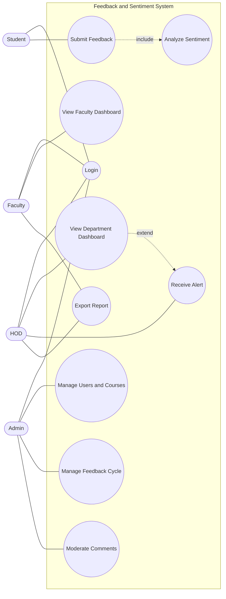

| Use case | Actor | Summary |
|---|---|---|
| Submit Feedback | Student | Rates aspects and comments for an enrolled course in an open cycle; system analyzes sentiment on save. |
| View Faculty Dashboard | Faculty | Sees aggregated ratings, sentiment split and themes for own courses only. |
| View Department Dashboard | HOD | Filters by semester, course, faculty, aspect; sees trends. |
| Manage Feedback Cycle | Admin | Opens/closes a cycle with dates. |
| Moderate Comments | Admin | Reviews flagged comments; approves or removes. |

### 4.2 Activity Diagram (Submit Feedback)

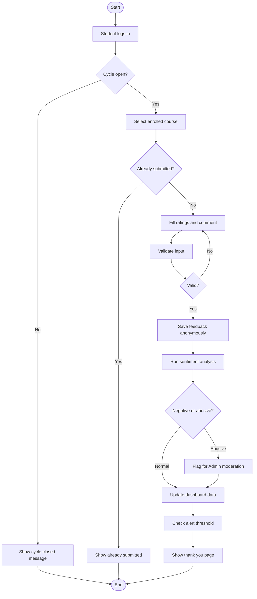

### 4.3 Class Diagram

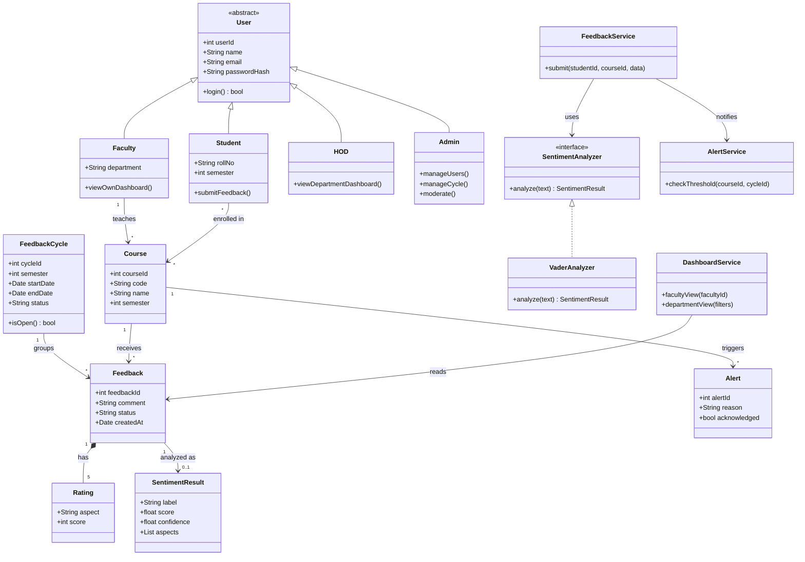

### 4.4 Object Diagram (one submission)

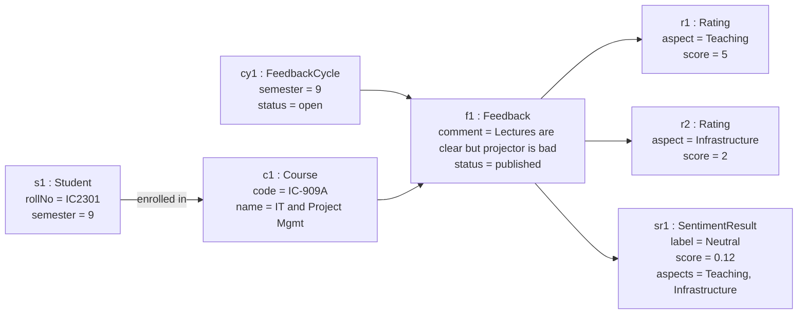

### 4.5 Sequence Diagram (Submit Feedback)

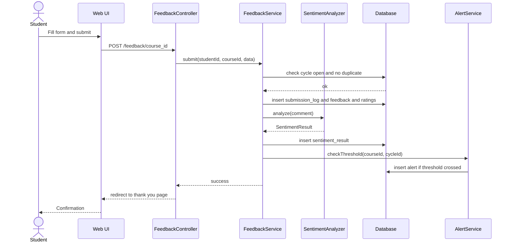

### 4.6 Communication Diagram (Submit Feedback)

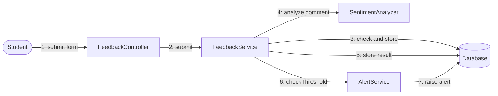

### 4.7 State Machine Diagram (Feedback lifecycle)

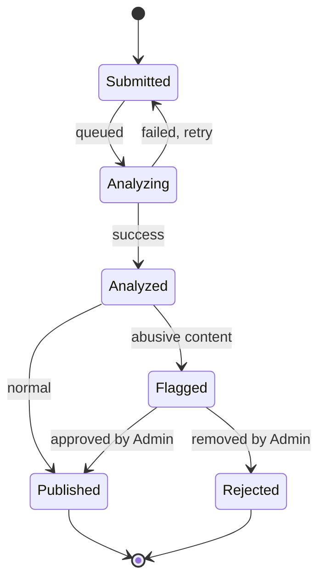

### 4.8 Package Diagram

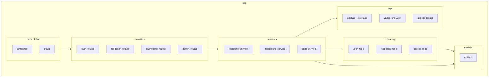

### 4.9 Component Diagram

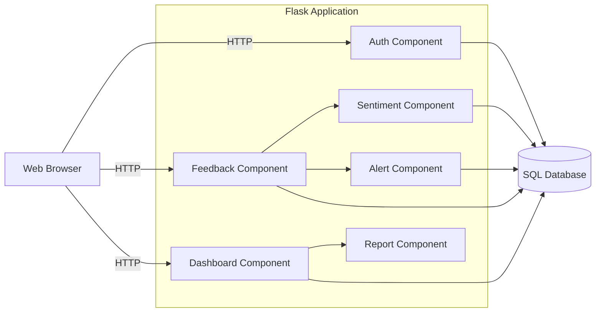

### 4.10 Deployment Diagram

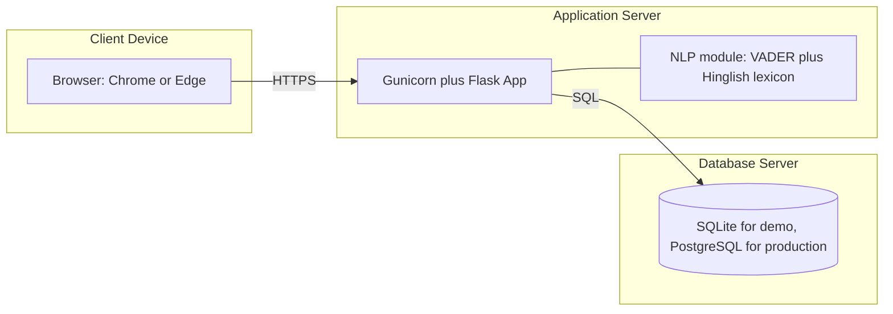

---

## Chapter 5: Database Design

### 5.1 ER Diagram

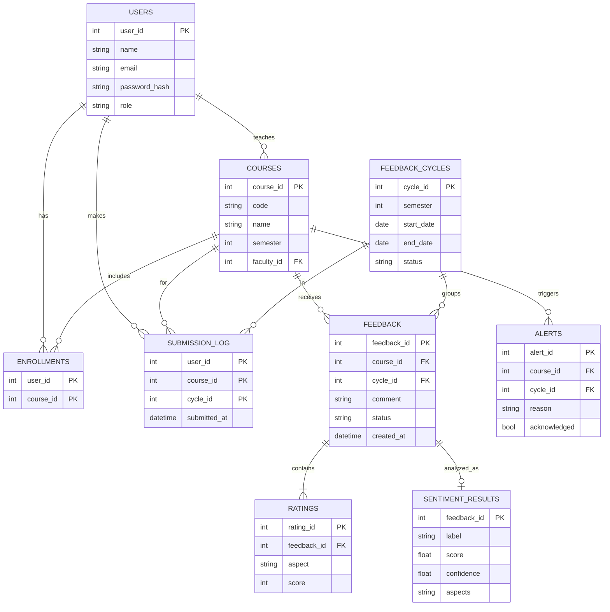

**Anonymity by design:** `feedback` has no `user_id`. Who submitted is recorded only in `submission_log` (to block duplicates, FR-06) and the two tables share no feedback key, so a comment cannot be traced back to a student (FR-07, NFR-04).

### 5.2 Relational Schema (SQL)

```sql
CREATE TABLE users (
  user_id INTEGER PRIMARY KEY,
  name TEXT NOT NULL,
  email TEXT UNIQUE NOT NULL,
  password_hash TEXT NOT NULL,
  role TEXT NOT NULL CHECK (role IN ('student','faculty','hod','admin'))
);

CREATE TABLE courses (
  course_id INTEGER PRIMARY KEY,
  code TEXT NOT NULL,
  name TEXT NOT NULL,
  semester INTEGER NOT NULL,
  faculty_id INTEGER NOT NULL REFERENCES users(user_id)
);

CREATE TABLE enrollments (
  user_id INTEGER REFERENCES users(user_id),
  course_id INTEGER REFERENCES courses(course_id),
  PRIMARY KEY (user_id, course_id)
);

CREATE TABLE feedback_cycles (
  cycle_id INTEGER PRIMARY KEY,
  semester INTEGER NOT NULL,
  start_date DATE NOT NULL,
  end_date DATE NOT NULL,
  status TEXT NOT NULL DEFAULT 'open' CHECK (status IN ('open','closed'))
);

CREATE TABLE submission_log (
  user_id INTEGER REFERENCES users(user_id),
  course_id INTEGER REFERENCES courses(course_id),
  cycle_id INTEGER REFERENCES feedback_cycles(cycle_id),
  submitted_at DATETIME NOT NULL,
  PRIMARY KEY (user_id, course_id, cycle_id)
);

CREATE TABLE feedback (
  feedback_id INTEGER PRIMARY KEY,
  course_id INTEGER NOT NULL REFERENCES courses(course_id),
  cycle_id INTEGER NOT NULL REFERENCES feedback_cycles(cycle_id),
  comment TEXT,
  status TEXT NOT NULL DEFAULT 'submitted',
  created_at DATETIME DEFAULT CURRENT_TIMESTAMP
);

CREATE TABLE ratings (
  rating_id INTEGER PRIMARY KEY,
  feedback_id INTEGER NOT NULL REFERENCES feedback(feedback_id),
  aspect TEXT NOT NULL,
  score INTEGER NOT NULL CHECK (score BETWEEN 1 AND 5)
);

CREATE TABLE sentiment_results (
  feedback_id INTEGER PRIMARY KEY REFERENCES feedback(feedback_id),
  label TEXT NOT NULL CHECK (label IN ('positive','neutral','negative')),
  score REAL NOT NULL,
  confidence REAL NOT NULL,
  aspects TEXT
);

CREATE TABLE alerts (
  alert_id INTEGER PRIMARY KEY,
  course_id INTEGER NOT NULL REFERENCES courses(course_id),
  cycle_id INTEGER NOT NULL REFERENCES feedback_cycles(cycle_id),
  reason TEXT NOT NULL,
  created_at DATETIME DEFAULT CURRENT_TIMESTAMP,
  acknowledged INTEGER NOT NULL DEFAULT 0
);
```

---

## Chapter 6: UI Mockups / Wireframes

**6.1 Login**
```
+--------------------------------------+
|        IIPS Feedback System          |
|                                      |
|   Email    [______________________]  |
|   Password [______________________]  |
|                                      |
|            [   Login   ]             |
+--------------------------------------+
```

**6.2 Student: Feedback Form**
```
+----------------------------------------------------+
| Course: IC-909A IT and Project Management   [Logout]|
| Cycle: Semester 9 (closes 10 Oct)                  |
|----------------------------------------------------|
| Teaching          ( )1 ( )2 ( )3 ( )4 ( )5         |
| Course Content    ( )1 ( )2 ( )3 ( )4 ( )5         |
| Labs              ( )1 ( )2 ( )3 ( )4 ( )5         |
| Infrastructure    ( )1 ( )2 ( )3 ( )4 ( )5         |
| Assessment        ( )1 ( )2 ( )3 ( )4 ( )5         |
|                                                    |
| Comments (English or Hinglish)                     |
| [______________________________________________]  |
| Your feedback is anonymous.                        |
|                         [ Submit Feedback ]        |
+----------------------------------------------------+
```

**6.3 Faculty Dashboard**
```
+----------------------------------------------------+
| My Courses > IC-909A                      [Export] |
|----------------------------------------------------|
| Avg Rating: 4.1/5   Responses: 38                  |
|                                                    |
| Sentiment:  [Pos 62%] [Neu 25%] [Neg 13%]  (donut) |
|                                                    |
| Ratings by aspect (bar chart)                      |
| Teaching     ||||||||||  4.5                       |
| Labs         |||||||     3.4                       |
| Infra        ||||        2.2                       |
|                                                    |
| Recent comments (anonymous)   [Filter: Negative v] |
| - "Projector issue every lecture"   Negative       |
| - "Examples were very helpful"      Positive       |
+----------------------------------------------------+
```

**6.4 HOD Dashboard**
```
+----------------------------------------------------+
| Department Dashboard   Semester [9 v] Aspect [All v]|
|----------------------------------------------------|
| Alerts (2):  IC-912B negative 41%  [Acknowledge]   |
|                                                    |
| Course comparison (bar chart by avg rating)        |
| Sentiment trend over semesters (line chart)        |
|                                                    |
| Course     Faculty    Avg   Neg%   Responses       |
| IC-909A    Dr. A      4.1   13%    38              |
| IC-912B    Dr. B      2.9   41%    35              |
|                                          [Export]  |
+----------------------------------------------------+
```

**6.5 Admin Panel**
```
+----------------------------------------------------+
| Admin:  [Users] [Courses] [Cycles] [Moderation]    |
|----------------------------------------------------|
| Feedback Cycles                       [+ New Cycle]|
| Sem 9   1 Oct - 10 Oct   Open    [Close]           |
| Sem 8   1 Mar - 10 Mar   Closed                    |
|                                                    |
| Flagged Comments (3)                               |
| "..."   [Approve] [Remove]                         |
+----------------------------------------------------+
```

---

## Chapter 7: Layered Architecture

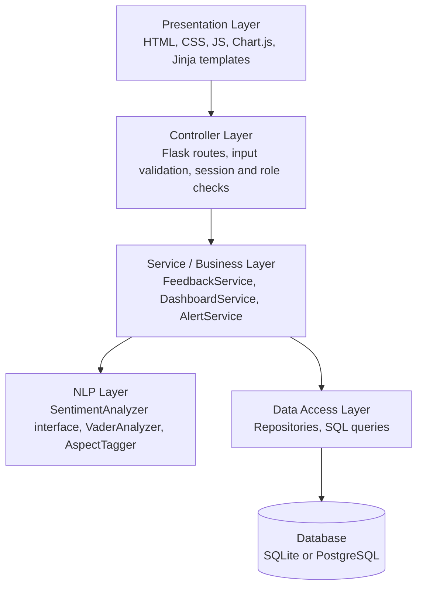

| Layer | Responsibility | Rule |
|---|---|---|
| Presentation | Render pages and charts | No business logic |
| Controller | Route requests, validate input, enforce role access | Calls services only |
| Service | Business rules (one submission, thresholds, aggregation) | Calls NLP and repositories |
| NLP | Sentiment and aspect detection | Replaceable behind an interface |
| Data Access | CRUD and queries | Only layer that touches SQL |

Each layer depends only on the layer below it, which keeps the system testable and lets the sentiment model be swapped later (NFR-07).

---

## Chapter 8: Design Patterns

| Pattern | Where used | Why |
|---|---|---|
| **Strategy** | `SentimentAnalyzer` interface with `VaderAnalyzer`, later `TransformerAnalyzer` | Swap the sentiment model without changing services |
| **Factory** | `get_analyzer(name)` | Create the right analyzer from config |
| **Observer** | `FeedbackService` notifies `AlertService` after each new result | Raise alerts without coupling submission logic to alert logic |
| **Repository** | `FeedbackRepo`, `UserRepo`, `CourseRepo` | Isolate SQL from business logic |
| **MVC** | Flask routes (controller), Jinja templates (view), entity classes (model) | Separate concerns in the web tier |
| **Singleton** | Database connection / analyzer instance | Load the NLP lexicon once, reuse everywhere |

**Strategy and Factory sketch**
```python
class SentimentAnalyzer(ABC):
    @abstractmethod
    def analyze(self, text: str) -> dict: ...

def get_analyzer(name: str = "vader") -> SentimentAnalyzer:
    return {"vader": VaderAnalyzer}[name]()
```

---

## Chapter 9: Software Design Document (SDD)

### 9.1 Introduction
Describes how the requirements in Chapter 3 are realized. Style: layered, object-oriented, Python/Flask.

### 9.2 Design Goals
Anonymity first, replaceable NLP model, simple deployment, clear separation of layers.

### 9.3 Module Design

| Module | Responsibility | Satisfies |
|---|---|---|
| Auth | Login, role-based access control | FR-01, NFR-03 |
| Admin | Users, courses, cycles, moderation | FR-02, FR-03, FR-11 |
| Feedback | Form, validation, duplicate check, anonymous storage | FR-04 to FR-07 |
| Sentiment | Preprocess, classify, tag aspects | FR-08 to FR-10 |
| Dashboard | Aggregation, filters, trends | FR-12, FR-13 |
| Alert | Threshold check, notify HOD | FR-14 |
| Report | PDF/CSV export | FR-15 |

### 9.4 Interface Design (REST endpoints)

| Method | Endpoint | Role | Purpose |
|---|---|---|---|
| POST | /login | All | Authenticate |
| GET | /courses | Student | Courses open for feedback |
| POST | /feedback/<course_id> | Student | Submit feedback |
| GET | /dashboard/faculty | Faculty | Own-course analytics |
| GET | /dashboard/department | HOD | Department analytics with filters |
| GET | /alerts | HOD | List alerts |
| POST | /admin/cycles | Admin | Create or close a cycle |
| GET | /admin/flagged | Admin | Flagged comments |
| POST | /admin/flagged/<id> | Admin | Approve or remove |
| GET | /export?format=pdf\|csv | Faculty, HOD | Download report |

### 9.5 Sentiment Processing Design
1. Clean text (lowercase, strip URLs and extra spaces).
2. Score with VADER extended by a small Hinglish lexicon.
3. Label: compound >= 0.05 positive, <= -0.05 negative, else neutral.
4. Tag aspects by keyword match.
5. Store label, score, confidence, aspects.

### 9.6 Security Design
Password hashing (Werkzeug), server-side session with role checks on every route, parameterized SQL, CSRF protection on forms, no student identity in any query result used by dashboards.

### 9.7 Error Handling
If analysis fails, the feedback stays saved with status `submitted` and is retried (NFR-06). Invalid input returns the form with messages. Duplicate or closed-cycle attempts return clear messages (HTTP 409 or 403).

### 9.8 Test Plan

| ID | Test | Expected |
|---|---|---|
| TC-01 | Student submits twice for same course and cycle | Second attempt rejected |
| TC-02 | Comment "lectures are bakwas and boring" | Label negative |
| TC-03 | Comment "teaching was accha and clear" | Label positive, aspect teaching |
| TC-04 | Faculty opens another faculty's course | Access denied |
| TC-05 | Submit after cycle closed | Rejected |
| TC-06 | Inspect dashboard and export output | No student identity present |
| TC-07 | Negative share crosses threshold | Alert created for HOD |

---

## Chapter 10: Prototype

### 10.1 Stack
Python 3, Flask, SQLite, vaderSentiment, Chart.js, plain HTML/CSS/JS (Jinja templates).

### 10.2 Folder Structure
```
feedback-sentiment-system/
├── app/
│   ├── __init__.py
│   ├── controllers/      # auth.py, feedback.py, dashboard.py, admin.py
│   ├── services/         # feedback_service.py, dashboard_service.py, alert_service.py
│   ├── nlp/              # analyzer.py, aspects.py
│   ├── repository/       # db.py, queries.py
│   ├── templates/        # login.html, feedback.html, faculty.html, hod.html, admin.html
│   └── static/           # css, js
├── schema.sql
├── seed.py               # demo users, courses, sample feedback
├── requirements.txt
├── tests/
├── docs/                 # this report, diagrams
└── README.md
```

### 10.3 Core Sentiment Module (`app/nlp/analyzer.py`)

```python
import re
from abc import ABC, abstractmethod
from vaderSentiment.vaderSentiment import SentimentIntensityAnalyzer

ASPECTS = {
    "teaching": {"teaching", "teacher", "lecture", "lectures", "explain", "explains", "faculty", "sir", "madam"},
    "labs": {"lab", "labs", "practical", "practicals", "experiment"},
    "infrastructure": {"wifi", "projector", "classroom", "library", "infrastructure", "internet"},
    "content": {"syllabus", "content", "curriculum", "topics", "notes"},
    "assessment": {"exam", "exams", "assignment", "assignments", "marks", "test", "grading"},
}

HINGLISH = {
    "accha": 1.8, "achha": 1.8, "badiya": 2.2, "mast": 2.0, "zabardast": 2.5,
    "bakwas": -2.5, "bekar": -2.0, "ghatiya": -2.5, "boring": -1.8,
}


class SentimentAnalyzer(ABC):
    @abstractmethod
    def analyze(self, text: str) -> dict: ...


class VaderAnalyzer(SentimentAnalyzer):
    def __init__(self):
        self.vader = SentimentIntensityAnalyzer()
        self.vader.lexicon.update(HINGLISH)

    def analyze(self, text: str) -> dict:
        text = re.sub(r"https?://\S+", " ", text or "").strip()
        tokens = set(re.findall(r"\w+", text.lower()))
        compound = self.vader.polarity_scores(text)["compound"]
        label = "positive" if compound >= 0.05 else "negative" if compound <= -0.05 else "neutral"
        aspects = [a for a, words in ASPECTS.items() if tokens & words]
        return {"label": label, "score": compound, "confidence": abs(compound), "aspects": aspects}


def get_analyzer(name: str = "vader") -> SentimentAnalyzer:
    return {"vader": VaderAnalyzer}[name]()
```

### 10.4 Core Submit Route (`app/controllers/feedback.py`)

```python
@bp.post("/feedback/<int:course_id>")
@login_required(role="student")
def submit_feedback(course_id):
    uid, cycle = session["user_id"], current_open_cycle()
    db = get_db()
    try:  # primary key (user, course, cycle) blocks duplicates
        db.execute("INSERT INTO submission_log VALUES (?,?,?,datetime('now'))", (uid, course_id, cycle))
    except sqlite3.IntegrityError:
        return "Already submitted", 409

    comment = request.form.get("comment", "")
    fid = db.execute(
        "INSERT INTO feedback(course_id, cycle_id, comment) VALUES (?,?,?)",
        (course_id, cycle, comment),
    ).lastrowid
    for aspect in ASPECT_NAMES:
        db.execute("INSERT INTO ratings(feedback_id, aspect, score) VALUES (?,?,?)",
                   (fid, aspect, int(request.form[aspect])))

    r = analyzer.analyze(comment)
    db.execute("INSERT INTO sentiment_results VALUES (?,?,?,?,?)",
               (fid, r["label"], r["score"], r["confidence"], ",".join(r["aspects"])))
    db.commit()
    check_alerts(course_id, cycle)  # Observer: raises alert if threshold crossed
    return redirect("/thanks")
```

`login_required`, `current_open_cycle`, `ASPECT_NAMES`, `get_db` and `check_alerts` are small helpers in the full app.

### 10.5 Run Instructions
```bash
python -m venv venv && source venv/bin/activate     # Windows: venv\Scripts\activate
pip install flask vaderSentiment
sqlite3 app.db < schema.sql
python seed.py
flask --app app run
```

### 10.6 Prototype Scope (what the demo must show)
1. Student logs in and submits feedback (ratings plus an English/Hinglish comment).
2. Duplicate submission is blocked.
3. Faculty dashboard shows sentiment split, aspect ratings and comments.
4. HOD dashboard shows course comparison and an alert.

---

## Chapter 11: GitHub Repository

- **Repo name:** `iips-feedback-sentiment-system`
- **Collaborators:** add both team members (Madhav Tawar, Hitesh Mahajan) to the repo.
- **Branches:** `main` plus one short-lived feature branch per person (e.g. `feat/sentiment`, `feat/dashboard`), merged via pull request; commit per feature.
- **Suggested commit trail:** `docs: add problem statement and SRS` → `docs: add UML models` → `docs: add DB design and wireframes` → `feat: schema and seed data` → `feat: sentiment module` → `feat: feedback submission` → `feat: dashboards` → `docs: SDD and README`.
- **README sections:** overview, features, architecture diagram, tech stack, setup, demo screenshots, project structure, link to `docs/`.

---

## Chapter 12: Final Presentation Outline (10 slides)

1. Title and team (Madhav Tawar IC-2K22-48, Hitesh Mahajan IC-2K22-39)
2. Problem and objectives
3. Stakeholders
4. Key requirements (FR/NFR highlights)
5. Use case and activity diagram
6. Class diagram and sequence diagram
7. Architecture (layered) and deployment
8. Database design and anonymity approach
9. Design patterns and prototype demo (screenshots or live)
10. Conclusion, limitations and future work

**Future work:** transformer-based multilingual model, topic modelling of comments, ERP integration, email alerts.

---

## Appendix: Deliverable Checklist

| # | Deliverable | Location | Status |
|---|---|---|---|
| 1 | Problem Statement | Ch 1 | Done |
| 2 | Stakeholder Analysis | Ch 2 | Done |
| 3 | SRS | Ch 3 | Done |
| 4 | Functional and Non-functional Requirements | Ch 3.3, 3.4 | Done |
| 5 | Use Case Model | Ch 4.1 | Done |
| 6 | Activity Diagram | Ch 4.2 | Done |
| 7 | Class Diagram | Ch 4.3 | Done |
| 8 | Object Diagram | Ch 4.4 | Done |
| 9 | Sequence Diagram | Ch 4.5 | Done |
| 10 | Communication Diagram | Ch 4.6 | Done |
| 11 | State Machine Diagram | Ch 4.7 | Done |
| 12 | Package Diagram | Ch 4.8 | Done |
| 13 | Component Diagram | Ch 4.9 | Done |
| 14 | Deployment Diagram | Ch 4.10 | Done |
| 15 | Database Design (ER and Schema) | Ch 5 | Done |
| 16 | UI Mockups / Wireframes | Ch 6 | Done |
| 17 | Layered Architecture | Ch 7 | Done |
| 18 | Design Patterns | Ch 8 | Done |
| 19 | SDD | Ch 9 | Done |
| 20 | Prototype | Ch 10 | Design and core code done; build the running app |
| 21 | GitHub Repository | Ch 11 | Plan done; create repo and push |
| 22 | Project Documentation | This file | Done |
| 23 | Final Presentation | Ch 12 | Outline done; build slides |

## Remaining Schedule (to 5 Oct)

| Day | Work |
|---|---|
| Fri 2 Oct (tonight) | Render and export diagrams, review this file |
| Sat 3 Oct | Build the running prototype, take screenshots |
| Sun 4 Oct | Push to GitHub, finalize README, build slides |
| Mon 5 Oct | Final review and submit |
